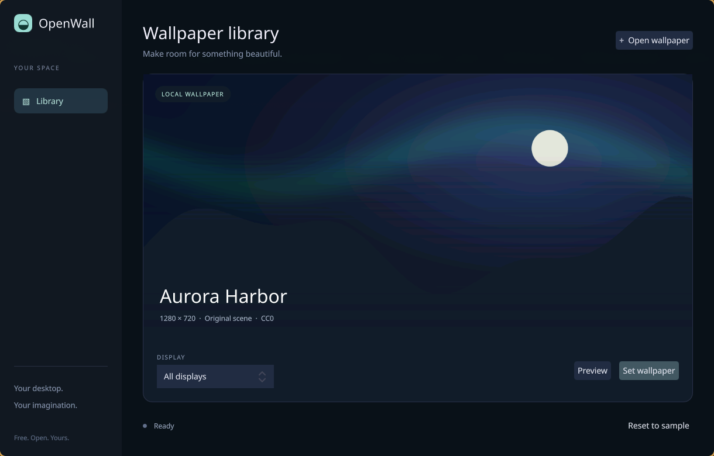

# OpenWall

Free, open-source live wallpapers for **macOS and Linux**, built primarily in Rust.
OpenWall aims to combine a polished native desktop experience with an independently
developed Wallpaper Engine compatibility layer. All features and source will remain free.

**Development snapshot:** this is the first implementation milestone, not a stable
Wallpaper Engine replacement. The platform and compatibility limits below are deliberate
and visible; a successful build does not mean a desktop has been hardware-qualified.



## Implemented

- Rust scene reader and Vulkan/Metal renderer for a small static 2D scene subset.
- Bounded access to loose assets, `scene.pkg` packages, and static raw `.tex` textures.
- Original sprite shader and CC0 sample artwork; no Wallpaper Engine installation needed.
- Qt Quick GUI driven by Rust through CXX-Qt: local file selection, preview, display selection,
  wallpaper placement, and stop controls. Wallpaper rendering runs in a separate process.
- Native Wayland layer-shell background surfaces with click-through input and output hot-plug handling.
- Per-surface fractional scaling through Wayland viewporter, with integer-scale fallback.
- Linux video playback through GStreamer/waylandsink, with native decoding and looping.
  Display resizing retains the existing decoder and playback position.
- macOS AppKit desktop window integration and AVFoundation video playback implementation.
- Offline PNG rendering, JSON compatibility reports, and desktop diagnostics.
- Static scenes render on changes and then sleep; no continuous animation loop for still content.

**Validated locally:** Fedora/Hyprland, Vulkan rendering, desktop surface creation/removal,
Qt GUI startup, and looping video. **Pending qualification:** macOS desktop/video behavior,
multiple monitors, fractional scaling, sleep/wake, and other GPU/compositor combinations.
CI builds macOS, but cannot certify real desktop behavior. An isolated headless Sway
suite verifies mixed scaling, rotation, output removal/reconnection, video resizing,
and worker/compositor crash cleanup using actual displayed pixels.

An [experimental Plasma 6 presentation shim](integrations/plasma/README.md) hosts external
workers under desktop widgets; its private-session tests do not yet qualify normal
GUI/CLI application on Plasma. A separate [GNOME background probe](integrations/gnome/README.md)
validates worker presentation and cleanup in a private GNOME 49 session; it is not yet
an installable desktop integration.
There is no X11 desktop backend yet. macOS currently applies to one selected/default
monitor. Linux video currently creates a decoder for each output. SceneScript, custom
effects, particles, web wallpapers, persistent libraries, discovery, and power rules
remain on the [roadmap](ROADMAP.md).

## Build

Use a current stable Rust toolchain. The GUI needs Qt 6.4+ development tools and QML
modules; the local build has been tested with Qt 6.10.3. The background worker does not
load Qt. Linux also needs Wayland, Vulkan, and GStreamer development libraries.

Ubuntu/Debian:

```sh
sudo apt install build-essential clang lld pkg-config libwayland-dev libxkbcommon-dev \
  libvulkan1 mesa-vulkan-drivers libgstreamer1.0-dev libgstreamer-plugins-base1.0-dev \
  gstreamer1.0-plugins-base gstreamer1.0-plugins-good gstreamer1.0-plugins-bad \
  qt6-base-dev qt6-declarative-dev qt6-declarative-dev-tools qt6-wayland \
  qml6-module-qtquick-controls qml6-module-qtquick-layouts qml6-module-qtquick-dialogs \
  qml6-module-qtquick-templates qml6-module-qtqml-workerscript
```

Fedora:

```sh
sudo dnf install gcc-c++ clang lld pkgconf-pkg-config wayland-devel libxkbcommon-devel \
  vulkan-loader-devel gstreamer1-devel gstreamer1-plugins-base-devel \
  gstreamer1-plugins-good gstreamer1-plugins-bad-free qt6-qtbase-devel qt6-qtdeclarative-devel qt6-qtwayland
```

macOS:

```sh
xcode-select --install
brew install qt
export QMAKE="$(brew --prefix qt)/bin/qmake"
```

Then build both executables in the same directory and launch the GUI:

```sh
cargo build --workspace --locked
cargo run -p openwall-ui
```

Use `cargo build -p openwall --no-default-features` for image/scene tools without
Linux GStreamer development dependencies. Decode support depends on installed open-source
GStreamer plugins, available hardware, and native macOS codecs. Decoder selection and
buffer caps are printed in worker diagnostics; zero-copy is not assumed.

## Try the CLI

```sh
cargo run -p openwall -- doctor
cargo run -p openwall -- outputs
cargo run -p openwall -- inspect samples/aurora-packed/project.json
cargo run -p openwall -- render samples/aurora/project.json --output /tmp/aurora.png
cargo run -p openwall -- preview samples/aurora/project.json
cargo run -p openwall -- apply samples/aurora/project.json --seconds 10
cargo run -p openwall -- apply /path/to/video.mp4 --output DP-1
```

The development build locates the bundled sample in this checkout. Run from a retained
source tree; standalone installers and application bundles have not been produced yet.
Closing the current GUI stops its workers. A persistent background manager is the next
runtime milestone. Ctrl+C removes CLI wallpaper surfaces; OpenWall does not rewrite your
desktop's wallpaper settings or terminate another wallpaper application.

`inspect` reports unsupported scene features. Preview/render refuse them by default;
`--allow-partial` explicitly permits a partial preview. Applying an unsupported scene is
rejected. This initial subset is not a claim that arbitrary Workshop scenes work.

## Development

```sh
cargo fmt --all --check
cargo clippy --workspace --all-targets -- -D warnings
cargo test --workspace
OPENWALL_TEST_GPU=1 cargo test -p openwall --test cli
QT_QPA_PLATFORM=offscreen QT_QUICK_BACKEND=software target/debug/openwall-ui --check
```

The GPU test compares packed-scene output with the original sample art. It is skipped
unless explicitly enabled. Hosted software-GPU CI checks correctness, not efficiency.
See [validation](docs/validation.md), [video measurement](docs/video-performance.md),
[architecture](docs/architecture.md),
[contributing](CONTRIBUTING.md), and [security](SECURITY.md).

## License and compatibility research

Original application code is **AGPL-3.0-or-later**. Samples are **CC0-1.0**.
Dependency licenses and source provenance are documented in [THIRD_PARTY.md](THIRD_PARTY.md).
The pinned format reader is reused from Kirie under its open-source license.

Wallpaper Engine is a separate product. OpenWall is independent and unaffiliated.
Imported wallpaper content remains subject to its creators' licenses. The repository
contains no proprietary engine binaries, shared engine assets, or Steam SDK. Operating
system frameworks and installed drivers are platform facilities, not redistributed
OpenWall runtimes.
