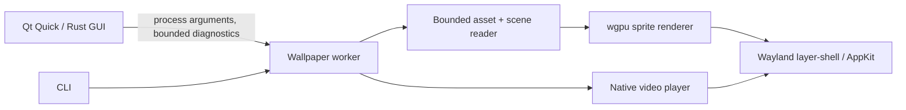

# Architecture

OpenWall separates user interface, content interpretation, and desktop presentation.

`openwall-core` contains immutable asset access, the declared compatibility subset,
original sample loading and reports. It has no Qt, GPU or desktop dependency. Package
data is read without extraction. Resource paths stay inside the selected wallpaper root.
PNG/JPEG/WebP and static raw TEX decoding is bounded; embedded-media TEX is rejected.

`openwall` is the actual GPU/media worker and diagnostic CLI. A scene's textures are
uploaded to the GPU and rendered only on presentation/configuration changes. Linux
Wayland surfaces are background-layer, non-focusable and click-through. Hot-plug removes
GPU presentation before native surfaces. The C pointer boundary documents connection and
surface lifetime requirements. Linux video uses GStreamer-owned Wayland subsurfaces;
the parent surface has a static shared-memory black buffer, so video workers never
initialize a second scene GPU/device. macOS uses AppKit and AVFoundation.

`openwall-ui` exposes Rust objects to QML through CXX-Qt. Content inspection runs in a
separate process on a background thread; the GUI never evaluates wallpaper scripts or
loads downloaded QML. Worker logs are continuously drained and capped at 16 KiB to
prevent pipe backpressure. Generation checks prevent stale inspection results replacing
a newer selection. The current GUI owns its workers and stops them on exit.

## Next boundary: manager

M1 will replace GUI-owned playback with a background Rust manager. It will own SQLite
state and output assignments, expose bounded/versioned same-user Unix-socket messages,
and pass read-only resources to workers. Prepare a candidate worker, await first-frame
readiness, then commit an assignment; failed candidates leave the previous wallpaper
running. Combine user/power/session/visibility pause reasons. Restart workers with
backoff, then retain a static/previous fallback after the restart budget is exhausted.

The current launcher does not implement that transaction or a restart policy. There is
no stable external plugin ABI. GNOME/Plasma adapters must remain minimal trusted
presentation shims; media decoding, scripts and shader compilation stay out of the shell.

## Compatibility boundaries

The parser dependency is pinned in Cargo.toml/Cargo.lock. OpenWall currently maps only
static orthographic image layers, transform/opacity data and the generic image material
to its own sprite shader. Unknown layer/model/material fields are reported; complex
scenes are rejected by default. This is an initial import subset, not full engine parity.

Future features need deterministic original fixtures, public API/behavior observations,
and comparisons with an owned reference installation. Replacement built-ins must be
independently written and openly licensed. Avoid dependence on official shared assets,
Windows executables, the proprietary Steam SDK or incompatible GPL-2.0-only renderers.
