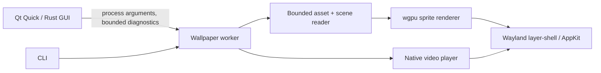

# Architecture

OpenWall separates user interface, content interpretation, and desktop presentation.

`openwall-core` contains immutable asset access, the declared compatibility subset,
original sample loading and reports. It has no Qt, GPU or desktop dependency. Package
data is read without extraction. Resource paths stay inside the selected wallpaper root.
PNG/JPEG/WebP and static raw TEX decoding is bounded; embedded-media TEX is rejected.

`openwall` is the actual GPU/media worker and diagnostic CLI. A scene's textures are
uploaded to the GPU and rendered only on presentation/configuration changes. Linux
Wayland desktop surfaces are background-layer, non-focusable and click-through. Hot-plug
removes GPU presentation before native surfaces. The C pointer boundary documents connection and
surface lifetime requirements. Linux video uses GStreamer-owned Wayland subsurfaces;
the parent surface has a static shared-memory black buffer backed by an anonymous memfd,
so video workers never initialize a second scene GPU/device or require a writable temporary
filesystem. macOS uses AppKit and AVFoundation.

Wayland video previews and experimental shell-hosted workers use an OpenWall-owned XDG
toplevel. GStreamer receives a separate container subsurface, preserving OpenWall's
exclusive ownership of root commits and XDG configure acknowledgments. This matters
because GStreamer's embedding constructor commits the parent it receives. The XDG root
stays unmapped until decoded video reaches the sink. A sink-buffer arrival is data
readiness, not proof of compositor presentation; M1 still needs transactional first-frame
acknowledgments. A startup deadline covers missing configure/data events; the launcher
must also bound blocked native-library calls. Playback waits on Wayland and media events
rather than periodic polling. Resize briefly synchronizes the container with its parent commit,
then resumes independently paced playback without restarting the decoder. Preview on X11
still uses GStreamer's automatic window; this does not provide X11 desktop integration.

GStreamer 1.28's output-registration callback has an upstream crash on repeated output
notifications. The [app-local helper](../integrations/gstreamer/README.md) keeps its
LGPL source and a minimal patch alongside the worker, loaded before plugin initialization
and retained for the process lifetime. Without that helper, known affected native
runtimes fail before desktop surface creation. Older 1.24/1.26 paths use the system
helper. This scoped dependency fix does not change codecs, driver selection, environment
variables or the scene renderer.

Wayland surface-local dimensions and physical buffer dimensions are separate. The
`wp_fractional_scale_v1` preference uses units of 1/120; buffers round to physical
pixels while `wp_viewport` keeps the logical destination and `wl_surface` buffer scale
at one. Compositors without those extensions use the preferred integer surface/output
scale. Dimension and allocation limits are checked before buffer creation or GPU
configuration. Video parent surfaces use a single black pixel when viewporter is
available, and rectangle changes resize the existing native video overlay instead of
restarting its decoder. Temporary frame-acquisition failures retry with a capped delay;
successful static presentation returns to an event-only wait. Compositor disconnection
terminates the worker with an error. Output removal releases the decoder/GPU surface,
viewport, fractional-scale object, layer surface, native surface and output binding.
Repeated identical scale preferences/configure notifications do not schedule a redraw;
configure serials are still acknowledged. This prevents a commit/notification feedback
loop on compositors that resend unchanged preferences.
New scene surfaces request presentation feedback and retry an unconfirmed initial
frame at 200 ms intervals, with at most three submissions. `wp_presentation` confirmation
ends recovery; compositors without it use the weaker frame-callback hint. Missing
feedback never creates a permanent redraw loop. This handles initial frames lost during
output recovery; a normal frame callback alone can arrive before a successful display
commit on older compositors.

Protocol references: [fractional scale](https://wayland.app/protocols/fractional-scale-v1),
[viewporter](https://wayland.app/protocols/viewporter), and the
[core Wayland specification](https://wayland.freedesktop.org/docs/html/apa.html).

`openwall-ui` exposes Rust objects to QML through CXX-Qt. Content inspection runs in a
separate process on a background thread; the GUI never evaluates wallpaper scripts or
loads downloaded QML. Worker logs are continuously drained and capped at 16 KiB to
prevent pipe backpressure. Generation checks prevent stale inspection results replacing
a newer selection. The current GUI owns its workers and stops them on exit.

## Next boundary: manager

M1 will replace GUI-owned playback with a background Rust manager. It will own SQLite
state and output assignments, expose bounded/versioned same-user Unix-socket messages,
and pass read-only resources to workers. Prepare a candidate worker, await first-frame
readiness, then commit an assignment; failed candidates leave the previous wallpaper
running. Combine user/power/session/visibility pause reasons. Restart workers with
backoff, then retain a static/previous fallback after the restart budget is exhausted.

The current launcher does not implement that transaction or a restart policy. There is
no stable external plugin ABI. GNOME/Plasma adapters must remain minimal trusted
presentation shims; media decoding, scripts and shader compilation stay out of the shell.

The [experimental Plasma shim](../integrations/plasma/README.md) implements that
presentation boundary using a Qt Wayland compositor inside a `WallpaperItem`. An
external Rust/GStreamer worker connects to a per-instance socket and supplies one XDG
toplevel; the shell displays its buffers below desktop widgets and forwards no input.
Disconnecting a duplicate client is deferred until Qt's creation callback has returned,
avoiding use-after-free in Qt's remaining role initialization. Worker exit/crash reveals
a static fallback and permits reconnection. This prototype uses test-only discovery and
is not connected to Apply. Shared-memory correctness has been tested; efficient hardware
buffer import and a versioned/authorized connection handshake remain open.

The [GNOME presentation probe](../integrations/gnome/README.md) uses a dedicated
`Meta.WaylandClient` connection and a native `Clutter.Clone` inside the desktop's
background actor. Ownership is determined by the connection; unrelated windows with
matching titles are preserved. Worker logs, startup and stop waits are bounded, and
source/clone teardown is tied to the specific worker instance. It does not install
shell-method overrides or provide finished app-list/workspace roles. Its native XDG video
path uses the same isolated container boundary as other Wayland previews. A minimized
source window can still feed a visible background clone, so future visibility policy must
use the adapter's actual background state rather than the source window's minimized state.
Normal GNOME Apply remains guarded.

## Compatibility boundaries

The parser dependency is pinned in Cargo.toml/Cargo.lock. OpenWall currently maps only
static orthographic image layers, transform/opacity data and the generic image material
to its own sprite shader. Unknown layer/model/material fields are reported; complex
scenes are rejected by default. This is an initial import subset, not full engine parity.

Future features need deterministic original fixtures, public API/behavior observations,
and comparisons with an owned reference installation. Replacement built-ins must be
independently written and openly licensed. Avoid dependence on official shared assets,
Windows executables, the proprietary Steam SDK or incompatible GPL-2.0-only renderers.
